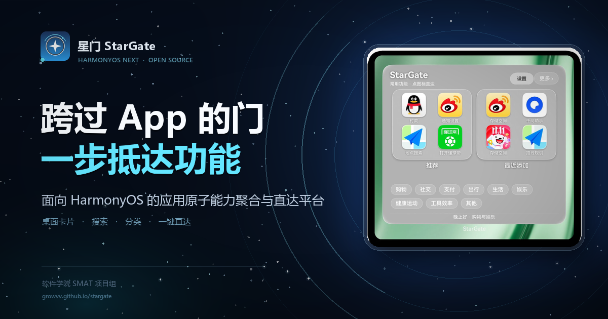

# 星门 StarGate

**面向 HarmonyOS 的应用原子能力智能聚合与直达平台**

<p align="center">
  <a href="https://growvv.github.io/stargate/">
    
  </a>
</p>

> 跨过 App 的门，一步抵达功能。

> **产品官网：** [growvv.github.io/stargate](https://growvv.github.io/stargate/)

> **提交材料：** [项目文档 PDF](submission/StarGate_项目文档.pdf) · [答辩 PPT PDF](submission/StarGate_答辩PPT.pdf) · [演示视频](submission/StarGate_演示视频.mp4) · [签名 HAP](submission/StarGate_签名HAP.hap)
>
> **项目负责人：** 刘发荣　　**完成单位：** 软件学院 SMAT 项目组

## 一、产品是什么

星门 StarGate 把散落在各个 App 里的高频功能，重新组织成一张可以直接点击的桌面能力面板。

用户不需要先打开 App、再找入口、再点进二级页面。在手机桌面添加星门的服务卡片后，常用功能、最近新增能力和分类入口会直接出现在卡片上；点一下，就进入目标 App 的具体功能页。

我们的判断是：**App 是容器，功能才是服务。** 用户真正需要的是“付款码”“扫一扫”“查快递”“开会入会”“路线规划”，而不是某个 App 的首页。星门做的事，就是把这些能力从 App 内部“提”到系统桌面，让功能成为第一入口。

## 二、解决什么问题

- **入口太深**：付款码、乘车码、会议入会、快递查询等功能，往往藏在 App 的三级页面里。
- **图标太多**：手机桌面被 App 图标占满，但用户常用的只是其中少数几个功能。
- **记不住路径**：知道要用某个功能，却不一定记得它在哪个 App、哪个标签页。
- **适老化不足**：长辈记不住图标和层级，但能认出“挂号”“缴费”“查快递”这样的功能名称。
- **能力不可见**：很多 App 已经公开了 Shortcut、Scheme、App Linking 等入口，但普通用户无从发现。

星门用一张卡片回答一个问题：**我现在要做的事，点哪里？**

## 三、产品形态：一张卡片，四个主入口

### 1. 桌面服务卡片

卡片是产品的主界面，也是用户接触星门的第一入口。卡片内是推荐、最近添加、分类三个区域；搜索作为并列的查找入口，从卡片右上角进入。

- **推荐**：按使用强度、时间衰减、时段偏好等信号动态排序。排序公式为 `score = 0.30·当日使用 + 0.20·当月使用 + 0.18·时间衰减 + 0.12·时段偏好 + 0.08·场景亲和 + 0.07·最近序列 + 0.05·置信度`；当日/当月按候选最大值归一化，时间衰减 τ=36 小时，同类目最多 2 条，同分按 id 稳定排序，候选不足不补位。
- **最近添加**：从用户新安装的应用中，发现并补充可用的原子能力；没有足够新能力时，用已有能力自然填充。
- **分类**：按购物、出行、办公、生活等场景组织能力，点分类进入该类目的完整列表。

每个格子都同时显示图标、功能名称和所属 App，用户不需要靠图标猜功能。

### 2. 搜索

与推荐、最近添加、分类并列的查找入口。从桌面卡片进入后，以 A–Z 分段展示全部能力，支持中文名称、App 名、分类与拼音首字母搜索。适合“我知道要做什么，但不想翻卡片”的场景。

### 3. 分类页

按生活场景浏览某一类能力。分类顺序可以由用户在设置中调整，常用分类可以前置。

### 4. 设置

支持分类长按拖动排序与卡片显示偏好。设置本身也通过卡片进入，不依赖独立 App 主界面。

## 四、我们探索过的四条路线

HarmonyOS 上把用户送到“目标 App 的具体功能页”，并不是只有一种做法。我们对比了四条路线，并分别分析了它们的能力边界与代价。

### 路线 A：应用内快捷方式（Shortcut）

应用主动声明快捷方式，系统在长按 App 图标时展示；用户点击快捷方式，直接进入对应功能页。

- **优点**：入口自然，体验稳定，符合系统规范。
- **局限**：完全依赖 App 主动声明，覆盖范围有限；用户仍需先找到 App 图标。
- **星门怎么用**：作为补充入口，适合已公开 Shortcut 的应用。

### 路线 B：链接路由（App Linking / Deep Link）

通过 App Linking 或 Deep Link 构造目标 Want，先用系统能力校验链接是否可打开，再拉起目标 Ability，落到具体功能页。

- **优点**：覆盖面最广，能精确落到功能页；可以跨 App 组织能力。
- **局限**：需要 App 公开可用的链接或 Scheme；部分链接需要真机验证。
- **星门怎么用**：作为主路线。统一能力目录中的大部分直达能力，都通过链接路由完成。

### 路线 C：系统选择器（startAbilityByType）

向系统发起某类能力请求，由系统按能力类型匹配可用应用，并在系统界面中完成选择。

- **优点**：不需要预先绑定固定包名，适合“打开地图”“发送文件”这类通用意图。
- **局限**：多一步系统选择，直达性弱；无法保证落到某个 App 的特定页面。
- **星门怎么用**：作为通用场景的兜底入口，不替代精确直达。

### 路线 D：UI 步骤自动化

预先录制或定制一串点击步骤，从桌面或应用首页开始，依次点按菜单、标签与列表项，自动走到目标功能页。

- **优点**：直观，不依赖 App 公开路由，理论上“屏幕上看得见”的功能都能到达。
- **局限**：步骤长、速度慢，页面改版或加载时序变化就可能失效，维护成本高。
- **星门怎么用**：仅作路线对比，最终不采用；产品坚持用系统公开接口完成直达。

### 最终选择

**B 为主，A / C 补场景，不采用 D。**

星门把采用的路线组织成一条完整的发现、验证与呈现链路：

1. **能力来源**：App 公开声明、系统意图与人工确认。
2. **入口准入**：真机确认可落到目标页面的入口，才写入能力目录。
3. **统一目录**：安装态过滤、分类、来源与验证状态、路由信息，形成呈现的唯一事实源。
4. **卡片呈现**：推荐排序、搜索与分组、最近添加、分类顺序。
5. **用户入口**：桌面卡片、搜索、分类页与设置。
6. **反馈回流**：点击结果、使用频次、失败原因，驱动下一轮排序与最近添加。

这条链路的核心原则是：**只呈现经过真机确认的入口；失败就如实报告，不回退 App 首页，也不用多条路由反复试探。**

## 五、产品原则

- **直达优先**：能一步到功能页，就不把用户送回 App 首页。
- **入口验证**：能力必须经过真机确认或人工复核，才进入正式目录。
- **诚实失败**：没有可用入口时明确提示“暂无可用直达入口”，不伪装成功。
- **安装态感知**：只展示当前设备上真实安装、真实可用的能力。
- **本地优先**：使用记录、排序偏好和能力状态保存在本机，不上传用户行为。
- **可维护**：能力目录保留来源与验证状态，便于持续复检与更新。

## 六、当前状态

星门已经在 HarmonyOS NEXT 真机上完成从桌面卡片、能力浏览、搜索、分类到一键直达的完整闭环：

- 桌面服务卡片可添加、可刷新、可点击直达；
- 推荐、最近添加、分类三种卡片内容形态可用；
- 搜索支持 A–Z 分段、中文与拼音定位；
- 分类页支持分类排序与配置；
- 设置页支持分类拖动排序与卡片显示偏好；
- 已产出可安装的签名 HAP，配套项目文档、答辩 PPT 和演示视频。

产品坚持“单一目标、失败即报告”的直达策略，不通过回退首页或多路由降级来掩盖失败。这让每一次点击的结果都是可信的，也为后续扩充能力目录留下了清晰的准入标准。

## 七、提交材料

“开源鸿蒙移动应用创新成果申报”的最终材料位于 [`submission/`](submission/)，该目录只放成品，不放制作脚本和中间文件。

| 文件 | 内容 |
|---|---|
| [`StarGate_项目文档.pdf`](submission/StarGate_项目文档.pdf) | 完整项目文档，含背景、产品设计、路线分析、模块说明、应用场景与工程验证 |
| [`StarGate_项目文档.docx`](submission/StarGate_项目文档.docx) | 项目文档可编辑版本 |
| [`StarGate_答辩PPT.pptx`](submission/StarGate_答辩PPT.pptx) | 答辩演示文稿，覆盖产品、功能、架构、路线、场景与生态价值 |
| [`StarGate_答辩PPT.pdf`](submission/StarGate_答辩PPT.pdf) | 答辩演示文稿 PDF 版 |
| [`StarGate_演示视频.mp4`](submission/StarGate_演示视频.mp4) | 逐页讲解的演示视频 |
| [`StarGate_签名HAP.hap`](submission/StarGate_签名HAP.hap) | 可安装到 HarmonyOS 真机的签名应用包 |

## 八、仓库结构

```
Stargate/
├─ harmony/                  HarmonyOS 工程
│  ├─ AppScope/              应用级配置
│  ├─ entry/                 应用源码与资源
│  ├─ test/                  自动化测试
│  ├─ tools/                 应用资源工具
│  ├─ build-profile.json5
│  ├─ hvigorfile.ts
│  ├─ oh-package*.json5
│  └─ README.md              工程说明：编译、安装与使用
├─ submission/               最终提交材料（仅成品，HAP 直接放在此处）
├─ docs/                     GitHub Pages 产品官网（静态站点）
├─ tools/submission/         文档、PPT、视频的生成脚本与素材（不进入提交包）
├─ tools/site/               官网静态资源与 Open Graph 图生成
└─ README.md
```

HarmonyOS 工程与提交材料分开存放：`harmony/` 是完整的 DevEco 工程，`submission/` 只保留可以直接提交的文件；文档、PPT、视频的生成脚本和素材统一放在 `tools/submission/`，便于维护和复现，但不会混入提交包。工程的编译、安装与使用说明见 [harmony/README.md](harmony/README.md)。

## 九、说明

- 项目中展示的第三方 App 名称、图标与商标归各自权利人所有，仅用于本地演示和能力识别，不代表任何合作或背书。
- 星门不修改、不注入第三方 App，也不模拟用户操作；所有直达均通过系统公开能力完成。
- 演示数据与截图来自项目真机验证环境，实际可用能力以设备安装情况为准。
