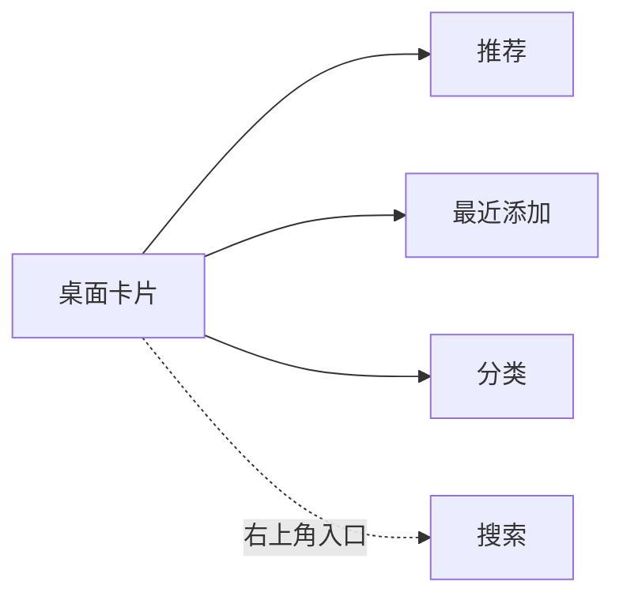
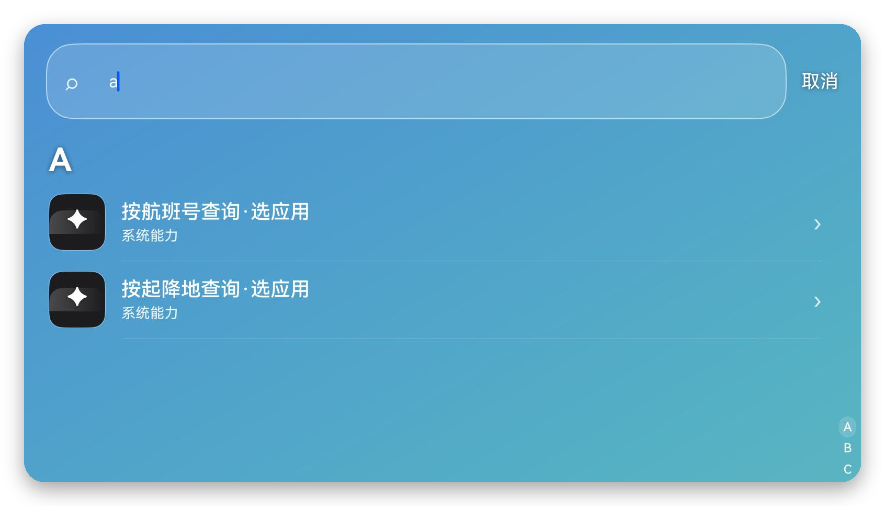
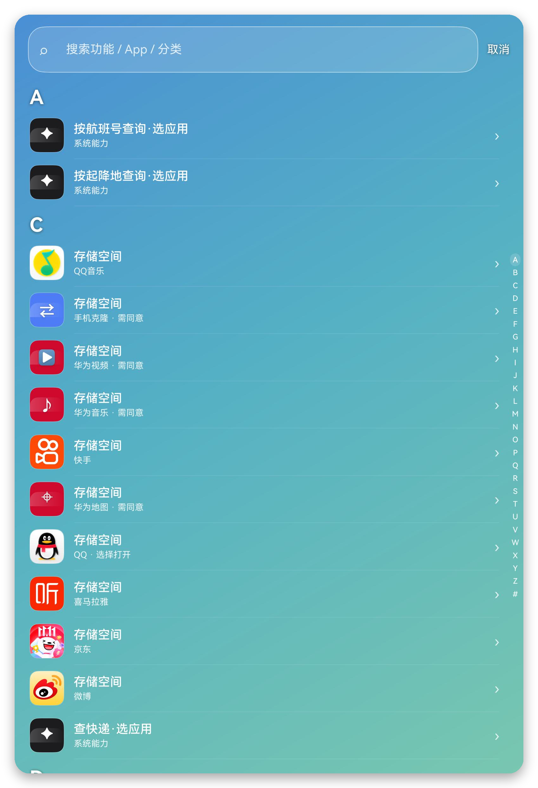
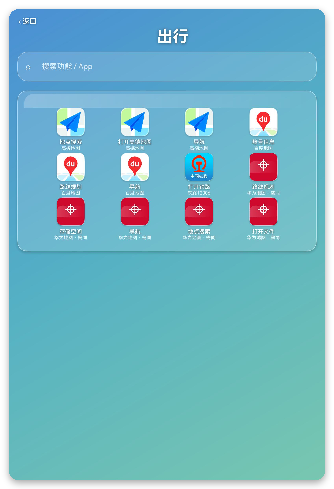
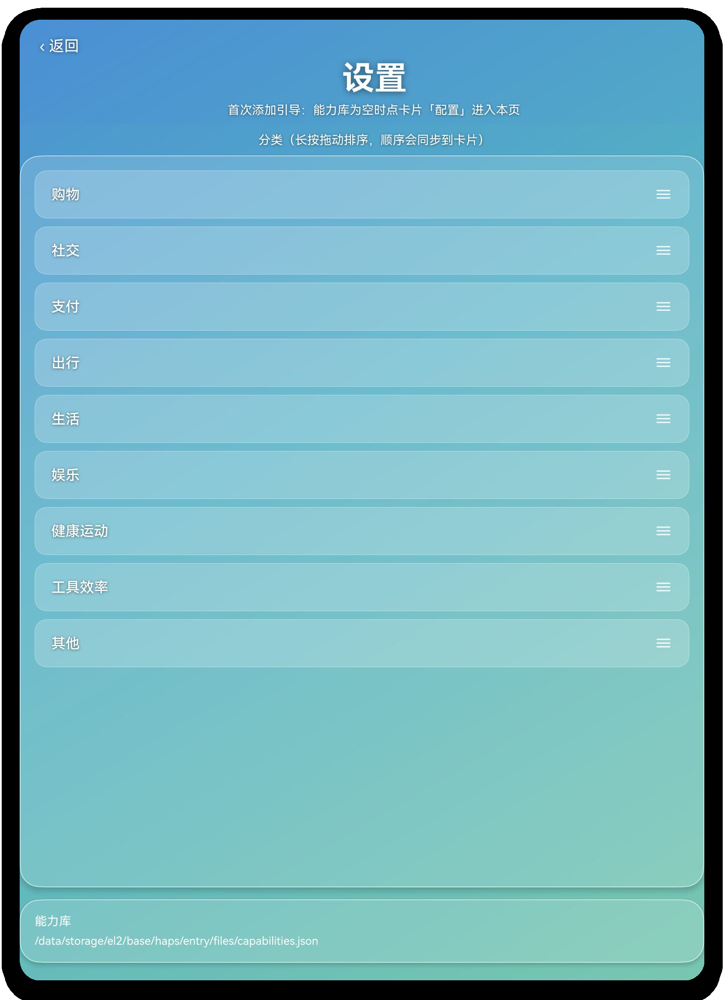
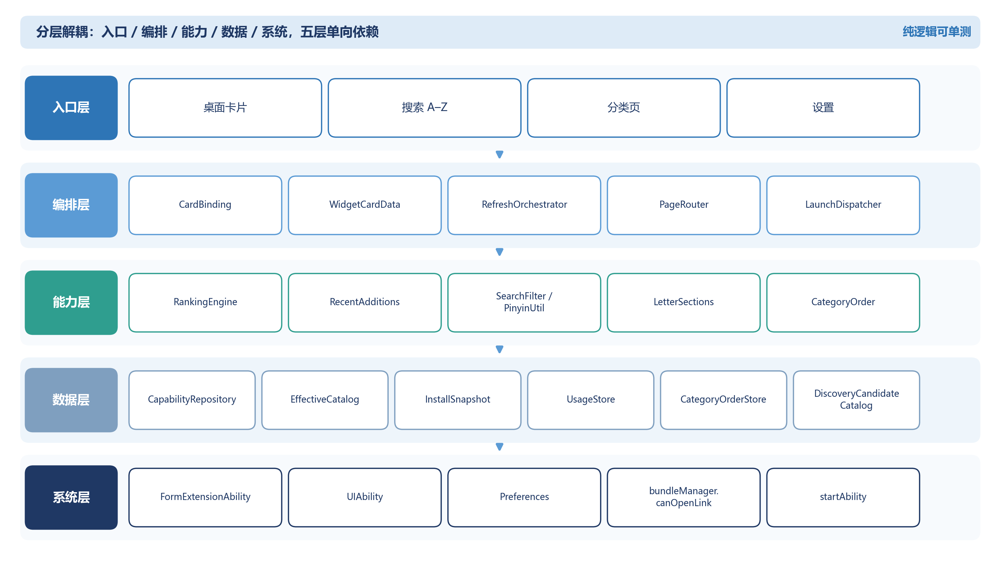

# StarGate HarmonyOS 工程

星门 StarGate 的 HarmonyOS NEXT 客户端：把散落在各个 App 里的常用功能，聚合到一张桌面卡片和一组轻量页面里，点一下就能进入目标 App 的具体功能页。

> 产品官网：<https://growvv.github.io/stargate/>

- 应用包名：`com.stargate.functionpanel`
- 技术栈：HarmonyOS NEXT · ArkTS · Stage 模型 · Form Kit
- 主入口：桌面服务卡片（应用不提供传统桌面图标）

## 桌面卡片


卡片常驻桌面，直接承载推荐、最近添加两个功能框与分类 chip；从卡片右上角还可以进入搜索页，按字母或拼音首字母定位全部能力。



推荐、最近添加、分类与搜索是同一层的使用方式：前三个直接铺在卡片上，搜索负责“知道名字、快速定位”的场景。

## 核心功能

### 1. 推荐

按使用强度与时间上下文排序，把此刻最可能用的功能放在卡片最前面。排序公式：

```text
score = 0.30·当日使用 + 0.20·当月使用 + 0.18·时间衰减
      + 0.12·时段偏好 + 0.08·场景亲和
      + 0.07·最近序列 + 0.05·置信度
```

当日/当月使用按候选集最大值归一化；时间衰减使用 `τ = 36 小时`；时段偏好来自历史小时分布，冷启动时使用类目先验；同类目最多 2 条，同分按 `id` 稳定排序，候选不足时返回真实条数，不补位。

### 2. 最近添加

从用户新安装或新检测到的 App 中补充可用能力。首次运行建立基线，已有 App 不冒充新能力；新出现的 App 按首次见到时间排序，每个 App 只占一格；没有新 App 时用能力库尾部自然填充。

### 3. 搜索



搜索页按拼音首字母分为 A–Z# 段，左侧是大写字母标题，右侧是常驻索引条。支持中文名称、App 名、分类与拼音首字母搜索；输入即筛，有输入时“取消”先清空，无输入时返回上一页。



### 4. 分类



按购物、社交、支付、出行、生活、娱乐、健康运动、工具效率等场景组织能力，点卡片上的分类 chip 即可进入该类目。

### 5. 设置



支持分类长按拖动排序与卡片显示偏好。分类顺序持久化在本地，并实时同步到桌面卡片。

## 核心实现



### 卡片与页面

- `entry/src/main/ets/form/FormAbility.ets`：`FormExtensionAbility`，负责卡片的创建、定时刷新与事件处理。
- `entry/src/main/ets/form/WidgetCard.ets`：卡片 UI。功能图标、分类 chip、更多入口都通过 `postCardAction('router')` 把参数交给 `EntryAbility`。
- `entry/src/main/ets/form/CardBinding.ets`：把能力目录、用量、安装快照与分类顺序组装成卡片数据。
- `entry/src/main/ets/form/RefreshOrchestrator.ets`：一次刷新的编排入口，产出不可变快照。
- `entry/src/main/ets/entryability/EntryAbility.ets`：页面路由与直达请求的统一承载者。
- `entry/src/main/ets/pages/`：搜索页、分类页、设置页，以及字母分段与页面路由等页面逻辑。

### 能力目录

- `CapabilityRepository`：从 `resources/rawfile/capabilities.json` 或外部配置读取能力库。
- `EffectiveCatalog`：按安装状态过滤，只保留当前设备真实可用的能力。
- `InstalledProbe`：使用 `bundleManager.canOpenLink` 探测路由是否可被系统打开。
- `InstallSnapshotStore`：保存安装快照与每个 App 的首次见到时间，驱动“最近添加”。

### 推荐与搜索

- `RankingEngine`：实现上面的加权公式、时间衰减、时段先验、类目打散与稳定排序。
- `RecentAdditions`：选择最近添加的能力，维护首次见到时间与每 App 一格规则。
- `SearchFilter` / `PinyinUtil`：中文名称、App 名、分类与拼音首字母过滤。
- `LetterSections`：A–Z# 分段与索引跳转。

### 一键直达

`LaunchDispatcher` 只读取一条最可靠路由，按 `route.kind` 构造一次显式 `Want`：

```ts
const want = {
  bundleName: fn.bundleName,
  uri: fn.route.uri
};
await context.startAbility(want);
```

- `deeplink` / `applinking`：`bundleName` + `uri`。
- `shortcut-param`：`bundleName` + `abilityName` + `moduleName` + `parameters`。
- `want`：`bundleName` + `uri` + `action`，按需带 `abilityName` / `moduleName`。
- `vertical`：不构造 `Want`，通过 `startAbilityByType` 交给系统按能力类型匹配应用。

启动失败时返回 `NO_AVAILABLE_ENTRY`，界面明确提示“暂无可用直达入口”，不回退 App 首页，也不在运行时尝试第二条路由。

## 目录结构

```text
harmony/
├─ AppScope/                 应用级配置（包名、版本、图标）
├─ entry/
│  ├─ src/main/ets/
│  │  ├─ data/               能力库、目录过滤、安装探测、搜索、排序数据
│  │  ├─ form/               桌面卡片、FormAbility、卡片数据编排
│  │  ├─ launch/             Want 构造与启动分发
│  │  ├─ model/              原子能力与路由数据结构
│  │  ├─ pages/              搜索、分类、设置与页面路由
│  │  └─ recommend/          推荐排序与最近添加
│  ├─ src/main/resources/
│  │  ├─ base/               图标、颜色、字符串、卡片配置
│  │  └─ rawfile/            能力库与候选能力
│  └─ src/test/              DevEco / hypium 测试入口
├─ test/                     Node 纯逻辑测试环境
├─ docs/screenshots/         README 截图
├─ build-profile.json5       构建与签名配置
└─ oh-package.json5          工程依赖
```

## 编译

### 方式一：DevEco Studio

1. 使用 DevEco Studio 5.0 或更高版本打开 `harmony/`。
2. 等待工程同步完成；如提示签名未配置，在 **File → Project Structure → Signing Configs** 中启用自动签名。
3. 选择 `entry` 模块，执行 **Build → Build Hap(s)/APP(s) → Build Hap(s)**。

### 方式二：命令行

在 `harmony/` 目录执行以下命令；DevEco Studio 的安装路径请按本机实际情况调整：

```bash
export PATH="/d/Application/DevEco Studio/jbr/bin:$PATH"
export NODE_HOME="D:/Application/DevEco Studio/tools/node"
export DEVECO_SDK_HOME="D:/Application/DevEco Studio/sdk"

"$NODE_HOME/node.exe" \
  "D:/Application/DevEco Studio/tools/hvigor/bin/hvigorw.js" \
  --mode module -p product=default -p module=entry@default \
  assembleHap --no-daemon
```

构建产物：

```text
entry/build/default/outputs/default/entry-default-signed.hap
```

签名说明：`build-profile.json5` 中的证书路径指向本机 DevEco 默认签名材料。换机器后请在 DevEco 中重新生成或选择本机签名配置，再执行构建。

## 安装与使用

1. 连接 HarmonyOS NEXT 真机，打开开发者模式与 USB 调试。
2. 使用 DevEco SDK 中的 `hdc` 安装（通常在 SDK 的 `toolchains/` 目录，若未加入 PATH 请使用绝对路径）：

   ```bash
   hdc install -r entry/build/default/outputs/default/entry-default-signed.hap
   ```

3. 在桌面长按空白处，进入 **编辑桌面 → 卡片**，找到 **StarGate**，把桌面卡片添加到桌面。
4. 在卡片上点功能图标即可直达目标页面；点分类 chip 进入分类页；从卡片右上角进入搜索页；点设置调整分类顺序与卡片偏好。
5. 入口不可用时，卡片或页面会显示“暂无可用直达入口”，不会跳回 App 首页。

## 测试

纯逻辑测试不依赖设备与 hvigor，在 `harmony/` 目录执行：

```bash
node test/run.mjs
```

测试加载器直接加载真实的 `.ets` 纯逻辑源码，覆盖排序、安装探测、目录过滤、搜索分组、Want 构造、失败语义与卡片编排等模块。需要 Node 26 或更高版本。

## 说明

- 星门只使用 App 公开声明的 Scheme、App Linking、Shortcut 与系统意图，不注入、不破解、不抓取私有接口。
- 所有能力、用量、安装快照与分类顺序都保存在本机，不上传用户数据。
- 截图中出现的第三方 App 名称、图标与商标归各自权利人所有，仅用于本地演示。
